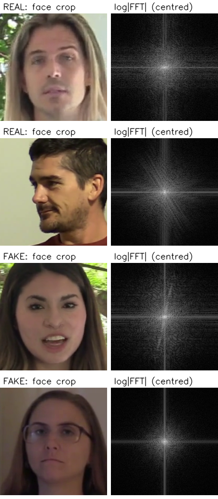
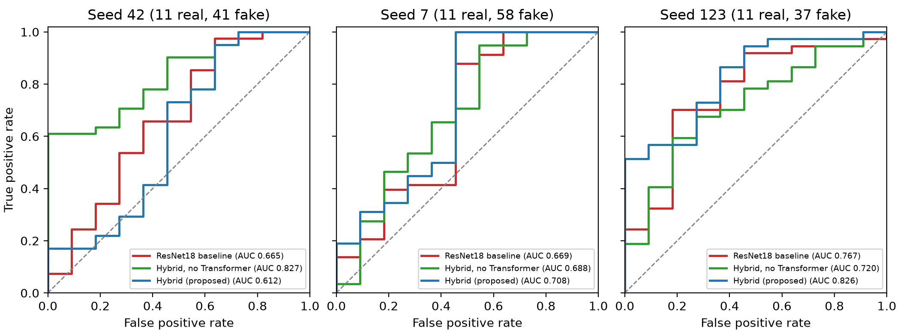
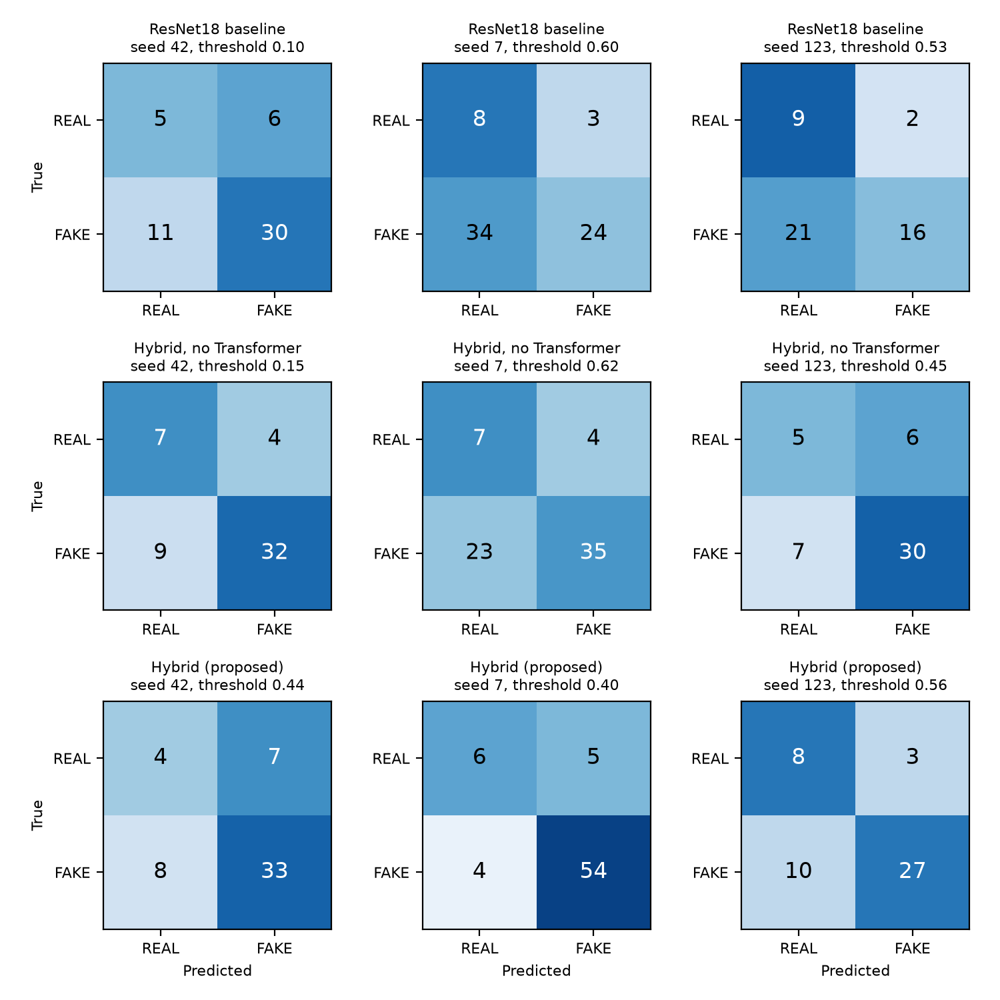

# DeepFake-Detection

A research-oriented video deepfake detector. Given a face video, it predicts
**REAL** or **FAKE** with a confidence score.

The main model is a **hybrid** that fuses three kinds of evidence:

- **Spatial** features: what each face frame looks like (ResNet18 pretrained on ImageNet).
- **Frequency** features: artefacts in the 2D FFT spectrum of each frame (a small CNN).
- **Temporal** relationships across the sampled frames (a Transformer encoder).

A frame-level **ResNet18 baseline** is trained alongside it for comparison.

## Architecture

```
Video
  -> Uniform frame sampling (8 frames)
  -> Face detection and crop, resize to 224x224
  -> For each frame:
       RGB face       -> ResNet18                      -> spatial embedding (512)
       grayscale face -> 2D FFT -> log magnitude -> CNN -> frequency embedding (128)
       concatenate    -> linear projection              -> frame embedding (256)
  -> Positional encoding + Transformer encoder (2 layers, 8 heads, d_model 256)
  -> Mean over frames -> linear head (1 logit, BCEWithLogitsLoss)
  -> REAL / FAKE + confidence
```

Baseline: ResNet18 scores each frame on its own, and the frame logits are
averaged to give one score per video.

What the model sees: the 8 face crops sampled from one video,


and, for the frequency branch, the log-magnitude Fourier spectrum of each crop:

<p align="center">
  
</p>

Full details are in [docs/architecture.md](docs/architecture.md).

## Repository layout

| Path | Contents |
|---|---|
| `preprocessing/` | Video reading, frame sampling, face cropping, Dataset, grouped splits, manifest builder |
| `models/` | Baseline, frequency branch, hybrid model |
| `training/` | Config (every field is a command-line flag) and the training loop |
| `evaluation/` | Metrics, checkpoint evaluation, comparison table |
| `inference/` | Single-video prediction |
| `app/` | Streamlit demo |
| `tests/` | End-to-end smoke tests with synthetic clips |
| `runs/eval/` | Test-set metrics for every trained model |
| `paper/` | LaTeX paper draft, figures and plotted data |
| `presentation/` | Script that builds the project presentation deck |
| `docs/` | Architecture, datasets, implementation, evaluation and UI notes |

Not in git: `data/` (dataset licence), `checkpoints/` (~500 MB of weights)
and the rest of `runs/` (per-run logs and splits).

## Setup

Python 3.12 was used. From the repository root:

```bash
python -m venv .venv
.venv\Scripts\activate            # Windows; on Linux/macOS: source .venv/bin/activate
pip install -r requirements.txt
```

Without a GPU, install the CPU build of PyTorch first:
`pip install torch torchvision --index-url https://download.pytorch.org/whl/cpu`.

`opencv-python` is pinned below 5.0 because 5.x no longer ships the Haar
cascade used by the default face detector.

Check that everything runs (synthetic clips and random weights, so this tests
the pipeline, not accuracy):

```bash
python -m tests.smoke_test
```

## Dataset

Experiments use the **DFDC training sample**: 400 labelled videos (77 REAL,
323 FAKE) from the Kaggle Deepfake Detection Challenge. The official download
was blocked for our account, so the files come from the Kaggle re-upload
`francisbawa/dfdc-train-sample`, which has the same file names and the original
`metadata.json`. The videos must not be redistributed.

Put the videos and `metadata.json` in `data/raw/dfdc/`, then build the manifest:

```bash
python -m preprocessing.make_manifest --metadata data/raw/dfdc/metadata.json --output data/raw/dfdc/manifest.csv
```

Splits are made per source video, not per frame or per clip: a fake and the
real video it was made from always land in the same split. With seed 42 the
split is train 294, val 54, test 52 videos. Details are in
[docs/datasets.md](docs/datasets.md).

## Usage

All commands run from the repository root.

Train:

```bash
python -m training.train --model baseline --manifest data/raw/dfdc/manifest.csv --train-jitter false --num-epochs 5 --batch-size 2 --best-metric roc_auc --run-name dfdc_baseline
python -m training.train --model hybrid   --manifest data/raw/dfdc/manifest.csv --train-jitter false --num-epochs 5 --batch-size 2 --best-metric roc_auc --run-name dfdc_hybrid
```

Add `--seed 7` (or another seed) for repeat runs. Add `--use-temporal false`
for the ablation without the Transformer. `python -m training.train --help`
lists every option.

Evaluate on the test split. `--val-threshold` picks the decision threshold on
the validation split instead of using 0.5. `--ci` adds 95% bootstrap
intervals for F1 and ROC-AUC to the comparison table:

```bash
python -m evaluation.evaluate --checkpoint checkpoints/dfdc_hybrid_best.pt --manifest data/raw/dfdc/manifest.csv --split test --val-threshold
python -m evaluation.compare --ci runs/eval/dfdc_*_test*.json
```

Predict a single video:

```bash
python -m inference.predict --video path/to/video.mp4 --checkpoint checkpoints/dfdc_hybrid_best.pt
```

Demo UI:

```bash
streamlit run app/app.py
```

Rebuild the ROC and confusion-matrix figures from `runs/eval/`:

```bash
python paper/figures/make_eval_figures.py
```

## Results

Test splits of the DFDC sample (48 to 69 videos, 11 of them real, per seed),
5 epochs, mean ± standard deviation over seeds 42, 7 and 123. F1 uses the
threshold chosen on the validation split. Per-run numbers with 95% bootstrap
intervals are in [runs/eval/dfdc_comparison_ci.md](runs/eval/dfdc_comparison_ci.md).

| Model | F1 | ROC-AUC |
|---|---:|---:|
| ResNet18 baseline | 0.642 ± 0.119 | 0.700 ± 0.057 |
| Hybrid without Transformer | 0.792 ± 0.061 | 0.745 ± 0.073 |
| Hybrid (proposed) | 0.848 ± 0.065 | 0.715 ± 0.107 |
| Always FAKE (reference) | 0.889 ± 0.022 | 0.500 |

ROC curves on each seed's test split:



Confusion matrices at the threshold chosen on the validation split:

<p align="center">
  
</p>

How to read these numbers:

- Both models with the frequency branch have a higher F1 than the baseline on
  every seed. ROC-AUC, which does not depend on the threshold, is close, and
  each hybrid variant beats the baseline on two of the three seeds.
- The Transformer gives no consistent gain over averaging the frame embeddings.
- About 80% of test videos are fake, so labelling everything FAKE scores a
  higher F1 than any model. ROC-AUC is the fairer comparison.
- With 11 real test videos the 95% intervals overlap for every pair of models,
  so none of these differences is statistically established.

## Limitations

- Small dataset (400 videos) and short training (5 epochs).
- The default face detector is OpenCV's Haar cascade. MTCNN is supported
  (`--face-detector mtcnn`, needs `pip install facenet-pytorch`) but was not
  used in the reported runs.
- No cross-dataset evaluation yet. FaceForensics++ and Celeb-DF are planned
  (see [docs/datasets.md](docs/datasets.md)).
- No audio analysis; the model only looks at video frames.
